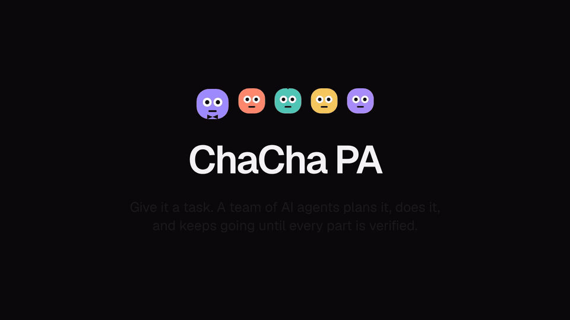

# Agent Orchestra

Give it any task. An orchestrator agent plans it, **creates its own specialist agents** (writing their
system prompts and choosing their tools), assigns them work, and **keeps looping until every piece is
independently verified**. Built on the Claude Agent SDK, so it runs on your Claude plan.

**ChaCha PA** is the web app around it: type a task, watch the team work live, on laptop or phone.

[](docs/media/chacha-pa-demo.mp4)

*A 23-second preview. [Download the full demo (97 s, with voiceover)](docs/media/chacha-pa-demo.mp4). Footage is from demo mode (`python -m server --fake`):
scripted agents, no model calls. Made with Remotion, source in [`demo-video/`](demo-video/).*

```
You: "Research the top 5 Indonesian e-wallets and write a comparison report"
        │
        ▼
ORCHESTRATOR ── create_agent ──► researcher (WebSearch, WebFetch, Write)
     │          create_agent ──► analyst    (Read, Write)
     │          create_agent ──► writer     (Read, Write, Edit)
     │
     ├─ assign_task(researcher, "research-1", done_when="5 files, each with 3 source URLs")
     │       └─ inner loop: worker → checker → FAIL? feedback → worker → checker → PASS
     ├─ assign_task(analyst, ...)   ...
     ├─ assign_task(writer, ...)    ...
     │
     └─ finish(...)  ← refused until every task on the board is done
        │
        └─ outer loop: if the orchestrator stops early, it gets nudged to continue
```

## The three loops

| Loop | Where | What it does |
|---|---|---|
| Agent loop | every agent | the model calls tools until it is done (handled by the SDK) |
| Inner loop | `assign_task` | worker attempt → independent checker → feedback → retry (up to 3) |
| Outer loop | `orchestrator.py` | orchestrator replans on failures; nudged if it stops before `finish` is accepted |

## Setup

Requires Python 3.10+.

```bash
pip install -r requirements.txt
```

**Use your Claude plan (no API key):** the SDK ships with the Claude Code CLI. Sign in once:

```bash
# if you already use Claude Code and are logged in, you're done
claude            # then run /login and pick your Claude account
```

Important: make sure `ANTHROPIC_API_KEY` is **not** set in your shell. If it is, the SDK uses it and
bills API credits instead of your plan.

```bash
echo $ANTHROPIC_API_KEY        # should print nothing
unset ANTHROPIC_API_KEY        # macOS/Linux
# Windows PowerShell:  Remove-Item Env:ANTHROPIC_API_KEY
```

## Run

```bash
# research / writing task
python main.py "Research the top 5 Indonesian e-wallets and write a comparison report as report.md"

# coding task: agents need Bash to run code and tests
python main.py --allow-bash "Build a Python CLI todo app with pytest tests that all pass"

# cheaper run
python main.py --worker-model haiku --max-agents 3 --max-cost 1 "..."

# long task from a file
python main.py -f task.txt
```

### Software engineering on an existing project

```bash
python main.py --allow-bash --repo ~/code/my-app \
  "Add password reset by email. Include pytest tests. All existing and new tests must pass."
```

What `--repo` does:
- refuses to start if the folder isn't a git repo or has uncommitted changes (`--allow-dirty` overrides)
- switches to a new branch `orchestra/<timestamp>`, so your main branch is never touched
- runs every agent inside your repo, while logs still go to `runs/`
- prints the `git diff` command to review everything afterwards. Merge only what you like.

Tips for coding tasks:
- Always use `--allow-bash`, so the checker can actually run your tests instead of just reading code.
- Put "tests must pass" or "`npm run build` succeeds" in the task. Concrete checks make the loops work.
- Bash runs real commands on your machine. For untrusted tasks, run inside Docker or a VM.
- Parallel agents share one folder, so the orchestrator is told to give them separate files.

Each run creates `runs/<timestamp>/`:

```
workspace/    files the agents produced (your deliverables)
log.jsonl     every event: agents created, tasks, attempts, verdicts
board.json    final task board + agent definitions + usage
final.md      the orchestrator's final answer
```

## Web app: ChaCha PA

Type a task in the browser and watch the team work live: agents appear as characters, tasks update
in place, the checker sends work back, and you get a clear ending. Works on a phone too.

```bash
pip install -r requirements.txt
cd web && npm install && npm run build && cd ..
python -m server              # open http://127.0.0.1:8000
python -m server --fake       # demo mode: a scripted run, no model calls, nothing billed
```

- Runs use your Claude plan login, same as the CLI. The sidebar shows "Claude plan" or "API key".
- Several runs can go at once. Closing the browser doesn't stop them.
- Tools come from `tools.catalog.json`: files, web, a real browser (Playwright MCP), shell (opt-in,
  sandboxed), Gmail and Google Calendar (set their URLs and tokens in `.env`, see `.env.example`),
  and any Claude Code plugin you put in `plugins/`. Pick which ones a run may use under Options.
- Anything that sends or changes something outside (email, calendar) pauses for your Approve / Deny.
- The server only listens on 127.0.0.1. To reach it from elsewhere, set `APP_TOKEN` and put it behind
  Cloudflare Tunnel + Access (see `docs/ARCHITECTURE.md`).

Docs: `docs/PLAN.md` (decisions), `docs/PRD.md`, `docs/DESIGN.md`, `docs/ARCHITECTURE.md`,
`docs/IMPLEMENTATION.md`. Instructions for AI coding agents: `AGENTS.md`.

## Guardrails

| Flag | Default | Why |
|---|---|---|
| `--max-agents` | 6 | stops it from spawning endless agents |
| `--max-assignments` | 15 | total `assign_task` calls |
| `--max-attempts` | 3 | retries per task in the inner loop |
| `--max-cost` | 5.0 | estimated USD of usage, then it must wrap up |
| `--allow-bash` | off | shell access is opt-in |

Also built in:
- Workers can only get tools from the catalog (`tools.catalog.json`). The orchestrator cannot invent tools.
- Outward tools (send email, create events) need your approval in the web app, and are denied in the CLI.
- Workers cannot create agents. Only the orchestrator can (no recursion).
- The checker is a separate agent with read-only tools (plus Bash if allowed, to run tests). It inspects files, not the worker's claims.
- Your personal Claude Code settings and CLAUDE.md files are ignored (`setting_sources=[]`).
- Everything runs inside `runs/<timestamp>/workspace`.

Note on cost: on a Claude plan the "cost" is the SDK's estimate in API dollars. You aren't charged
that amount, but it uses your plan's 5-hour and weekly limits, so it is still a good meter.
A typical run with 3 to 4 agents is roughly 20 to 40 model calls.

## Project layout

```
main.py                    CLI
orchestra/
  config.py                models, budget, tool registry
  prompts.py               orchestrator + checker prompts
  runner.py                runs one agent via claude_agent_sdk.query()
  tools.py                 create_agent / assign_task / view_board / finish
  orchestrator.py          outer loop with ClaudeSDKClient
  state.py                 board, usage counters, logging
tests/test_tools.py        offline tests (fake runner, no model calls)
```

## Tests

```bash
python -m pytest tests -q
```

## Ideas to extend

- Parallel `assign_task` with per-agent subfolders
- Persist good agent definitions and reuse them across runs
- Human approval step before `finish`
- Swap to an API key for production use (set `ANTHROPIC_API_KEY`, nothing else changes)
